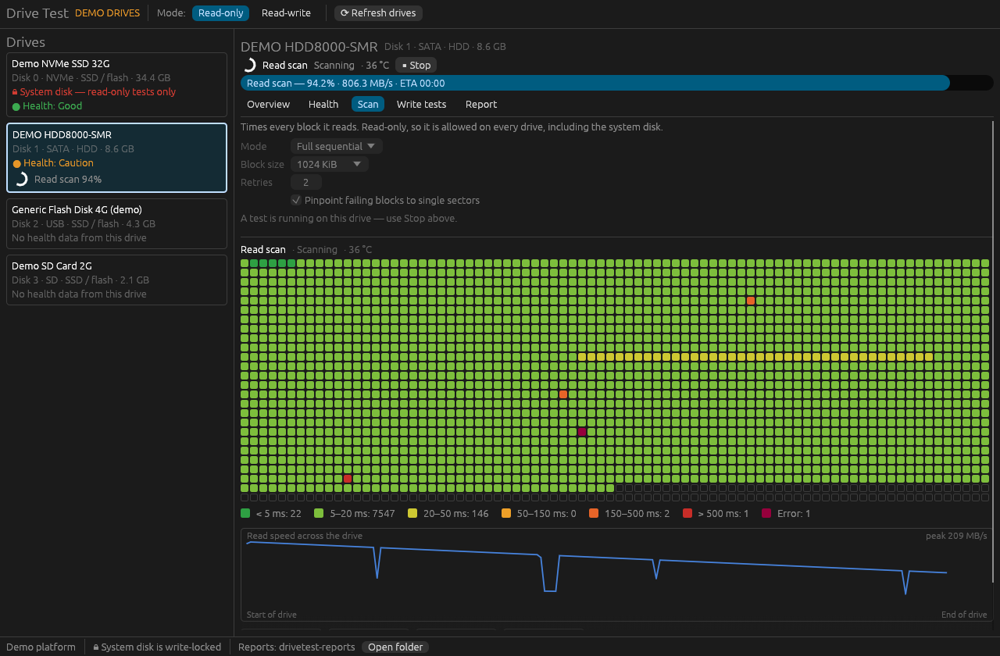
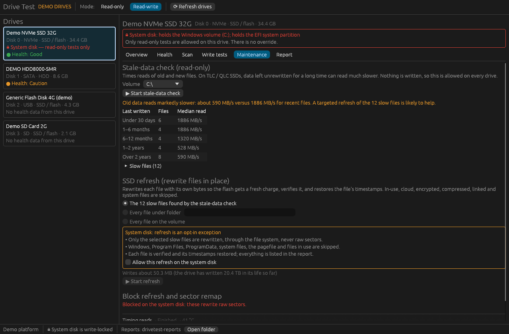

# Drive Test

A Windows drive-testing tool written in Rust, with a desktop GUI and a command-line interface.
It checks drive health, scans every sector for slow or unreadable areas, and runs write tests
that catch fake-capacity USB sticks and SD cards. Write tests are refused on the system disk.



## Safety model

The rules live in the engine (`drivetest-core/src/policy.rs`), not the UI. The only code that
can obtain a writable raw disk handle is `Policy::begin_destructive`, and the authorization
type it creates cannot be constructed anywhere else.

| Tier | What it does | System disk | Data drive |
| --- | --- | --- | --- |
| Read-only | Health, self-tests, read scans, stale-data check | Allowed | Allowed |
| Non-destructive write | Free-space verify, speed-class check (temporary files, then deleted) | **Blocked** | Read-write mode |
| File refresh | Rewrites files in place with their own bytes | **Opt-in, selected files only** | Read-write mode |
| Raw (keeps data) | Block refresh, sector remap | **Blocked, no override** | Read-write mode + typed serial number |
| Destructive | Raw pattern writes; erases the drive | **Blocked, no override** | Read-write mode + typed serial number |

- **System disk detection.** A disk counts as the system disk if it holds the Windows folder, the
  boot / EFI system partition, `pagefile.sys`, `hiberfil.sys` or `swapfile.sys`. If any check
  fails, drives that were not positively identified become *Undetermined* and are treated
  exactly like the system disk (fail closed).
- **Before a destructive test**, the policy re-reads the drive list and confirms the same serial
  and capacity are still at that position, then locks and dismounts every volume on the drive.
  If any volume is in use, nothing starts. The Windows layer repeats the system-disk and serial
  checks independently before it opens a writable handle.
- **Free-space verify** re-reads the drive list before starting, writes through the volume's
  GUID path (which cannot be redirected to another volume), confirms the test folder really is
  on that volume, and on completion deletes only the files it created.
- **The one system-disk exception is file refresh**, and only as an explicit opt-in on a list of
  selected files (normally the slow files found by the stale-data check). It goes through the
  file system, never raw sectors, and skips Windows, Program Files, ProgramData, system files,
  the pagefile, files in use, cloud placeholders, encrypted, compressed, sparse and linked files.
- **Device commands are allow-listed.** Only ATA IDENTIFY and SMART read / self-test, the NVMe
  self-test and log reads, and SD register reads (CMD9, CMD10, ACMD13) can be sent; anything
  else is refused in code.
- **The app always starts in Read-only mode.** Destructive controls are hidden until Read-write
  mode is chosen.

## What's in this build

**Health**
- SMART over ATA pass-through (SATA), SMART over SAT for USB-to-SATA enclosures, and the NVMe health log.
- Plain-language verdict: Good, Caution or Replace, with reasons and SSD life remaining.
- Built-in short and extended self-tests: SATA, SATA behind USB bridges that support SAT, and NVMe.
- SD cards in native slots: identity from the CID register (manufacturer, OEM, product, serial,
  manufacture date), capacity from the CSD register, and speed ratings from the SD Status
  register. Blank IDs or a CSD capacity that disagrees with the reported size are flagged as
  counterfeit signals.
- USB bridge and SD host identification from the Windows device tree (VID / PID).
- SMR/CMR assessment from the drive's self-report, hints (TRIM on a spinning disk, known SMR models) or the SMR write test.

**Read scan** (read-only, works on any drive)
- Sequential, random-sample, butterfly and range modes; unbuffered, sector-aligned I/O.
- Every block timed and placed in seven latency buckets; failing blocks narrowed down to single sectors.
- Live block grid, speed curve across the drive, latency percentiles (p50 / p99 / p99.9 / max).
- Weak-region detection, slow-block count, and all-zero (trimmed) block detection on SSDs.
- Bad sectors mapped to the files that occupy them (NTFS).
- SMART before and after every test; counters that rise during the test are flagged.

**Write tests** (Read-write mode, never on the system disk)
- *Free-space verify* (non-destructive): fills free space with self-describing test files, verifies, deletes them.
- *Fake-capacity quick probe* (destructive): writes and verifies sampled positions, estimates real capacity.
- *Full write + verify* (destructive): every block; finds bad sectors, fake capacity and the SSD write-cache cliff.
- *SMR write test* (destructive): sustained random writes; a drive-managed SMR disk collapses once its cache fills.

**Speed-class check** (non-destructive)
- Writes a temporary file and measures sustained sequential write (slowest 64 MB window),
  sequential read, and random 4K read / write IOPS, then compares them with C2–C10, U1/U3,
  V6–V90 and A1/A2. Ratings are pre-filled from the card's SD Status register when available.

**Maintenance**
- *Stale-data check* (read-only): samples files by age and times unbuffered reads, to find old
  data that reads slowly on TLC / QLC SSDs.
- *SSD file refresh*: rewrites files in place with their own bytes, verifies each chunk with an
  uncached read-back, and restores timestamps and attributes. Every target must be a path inside
  the chosen volume, and each opened file's real location (links, junctions, short names
  resolved) is checked again before writing. Tools that watch the NTFS change journal still see
  the files as rewritten; hard-linked files are rewritten once per link; a program writing
  through a memory-mapped view without an open handle is not blocked. Targeted (the slow files), a folder, or a whole
  data volume; before / after read speeds are reported.
- *Block refresh* (raw, keeps data): rewrites every block that holds data, or only blocks that
  read slower than a threshold; all-zero (trimmed) blocks are skipped.
- *Weak-sector remap* (raw, keeps readable data): overwrites confirmed unreadable sectors with zeros and checks whether the replacement bytes read back, using the bad sectors from the last scan or a fresh scan. Scan and
  stale-check reports are only accepted for the exact drive (serial, capacity, sector size) and
  volume they were made for.



**Everything else**
- JSON report after every run, holding the raw per-block data.
- Keeps the PC awake during tests; temperature sampled every 30 s.
- `--demo` mode with four simulated drives, so every feature can be tried without hardware.

### Not in this build yet

NVMe-over-USB health, and device hot-plug notifications (the drive list refreshes every 15 s
instead).

**Hardware-dependent features.** SD register reading uses the Windows SD storage driver, which
passes only some commands through; on many systems the CID / CSD reads will be refused and the
card is identified from its device ID instead. SD cards in USB readers have no register access.
NVMe self-tests need Windows 10 1903 or later with the Microsoft NVMe driver; some vendor
drivers refuse the command. In each case the app reports what it could not read.

## Requirements

- Windows 10 or 11, x64.
- Rust 1.95 or newer with the MSVC toolchain (`rustup default stable-x86_64-pc-windows-msvc`)
  and the Visual Studio Build Tools (C++ workload) for the linker.
- Administrator rights for real drives. The GUI asks for them through its manifest; run the CLI
  from an Administrator terminal.

## Build and run

```powershell
cargo build --release

# GUI (prompts for administrator rights)
.\target\release\drivetest-gui.exe

# GUI with simulated drives
.\target\release\drivetest-gui.exe --demo

# CLI
.\target\release\drivetest.exe list
```

The GUI and CLI also build on Linux, where they always use the demo drives (useful for UI work).

## CLI

```text
drivetest list                                   List drives, roles and volumes
drivetest health 2                               SMART / NVMe health and verdict
drivetest self-test 2 [--extended]               Drive's built-in self-test
drivetest scan 2                                 Full sequential read scan
drivetest scan 2 --mode random --percent 2       Quick random sample
drivetest scan 2 --mode range --start-gb 100 --end-gb 200
drivetest verify-free-space 2 --volume E:\ --read-write [--max-gb 50]
drivetest write-test 2 --kind probe --read-write            Prompts for the serial
drivetest write-test 2 --kind full  --read-write --confirm-serial ABC123
drivetest write-test 2 --kind smr   --read-write --smr-gib 40 --smr-minutes 20
drivetest write-test 2 --kind refresh --read-write [--slower-than-ms 50]   Block refresh (keeps data)
drivetest write-test 2 --kind remap   --read-write --allow-zero-unreadable [--from-report scan.json] Sector remap
drivetest stale-check 0 --volume C:\                         Read-only
drivetest refresh-files 0 --volume C:\ --read-write --from-report stale.json --system-disk-opt-in
drivetest refresh-files 2 --volume E:\ --read-write --whole-volume
drivetest speed-class 3 --volume G:\ --read-write [--claimed V30,U3,A2] [--test-gb 4]
```

Add `--demo` to any command to use the simulated drives. Reports are saved to
`Documents\DriveTest\reports` (override with `--report-dir`, skip with `--no-report`,
print with `--json`). Ctrl+C stops a test cleanly and still writes a partial report.

Exit codes: `0` passed, `1` problems found, `2` incomplete, unsupported or error, `3` refused by the safety policy.

## Reports

Each run writes `diskN-<test>-<timestamp>.json` containing the drive identity, test settings,
health before and after (with any counters that rose), findings in plain language, and the raw
data: per-block latency and status, bad sectors with their files, speed curves, write-test
verdicts and temperatures. `schema` is bumped on incompatible changes.

## Project layout

```text
crates/
  drivetest-core/   Platform-independent engine: policy, scan, write tests, free-space
                    verify, health parsing, reports, job runner, demo platform. Unit-tested.
  drivetest-win/    Windows layer: enumeration, system-disk detection, raw I/O,
                    ATA / SAT / NVMe pass-through, volume locking, file mapping.
  drivetest-cli/    `drivetest` command-line front end.
  drivetest-gui/    `drivetest-gui` desktop app (egui / eframe).
```

## Development

```powershell
cargo test --workspace      # core tests run against the simulated drives
cargo clippy --workspace --all-targets
```

The core is tested without hardware through `DemoPlatform`, which models bad sectors, weak
regions, slow spots, a wraparound fake USB stick, an SD card write cache and drive-managed SMR.

## Testing on real hardware

The Windows layer type-checks and the engine is unit-tested, but this code has not yet been
run against physical drives. Before trusting it with anything that matters:

1. Start with read-only commands (`list`, `health`, `scan`) and confirm the system disk is
   reported correctly.
2. Try write tests on a virtual disk first. In an Administrator `diskpart`:
   `create vdisk file=C:\vhd\test.vhdx maximum=4096 type=expandable`, then `attach vdisk`.
   It appears as a new physical drive (bus type "Virtual").
3. Then use a spare drive whose contents you do not need.

## License

No license has been chosen yet. Add one (for example MIT or Apache-2.0) before publishing.
